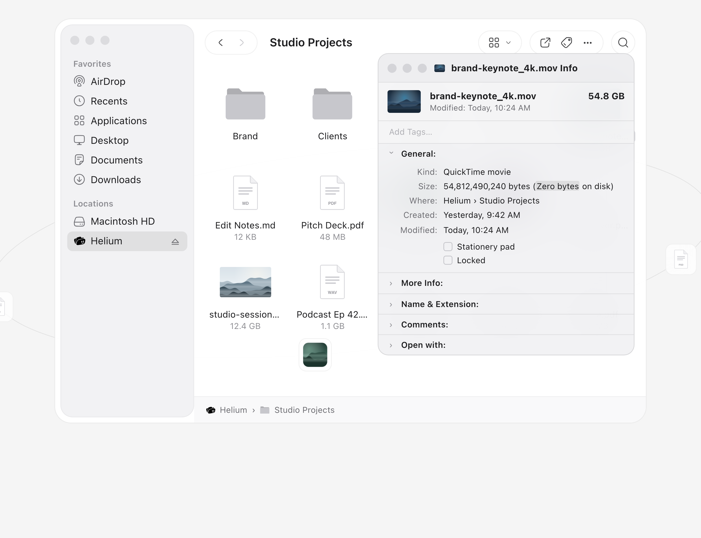
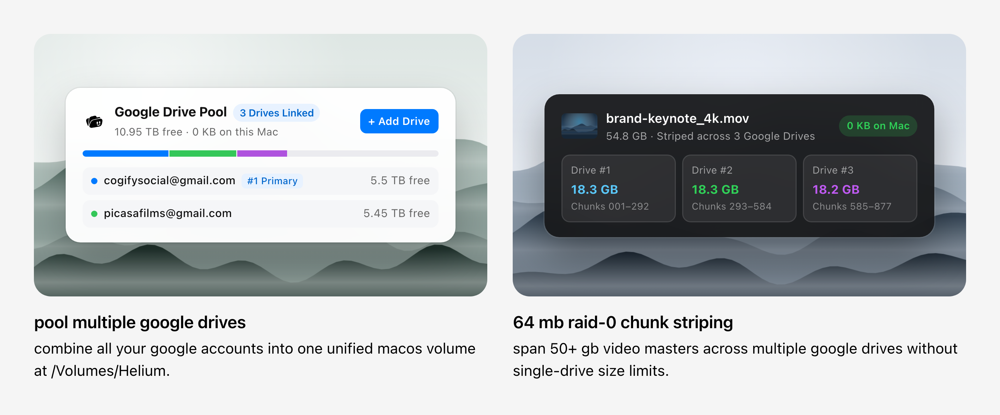
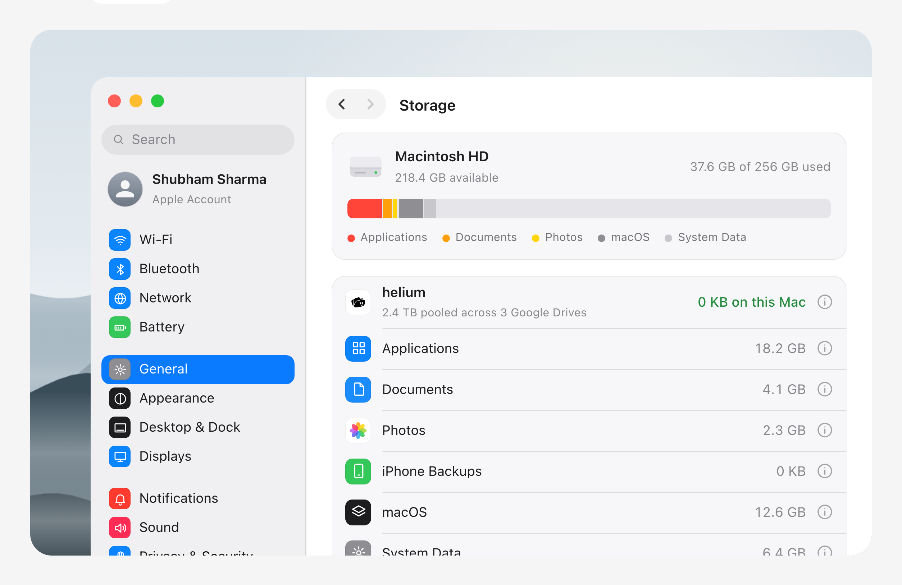
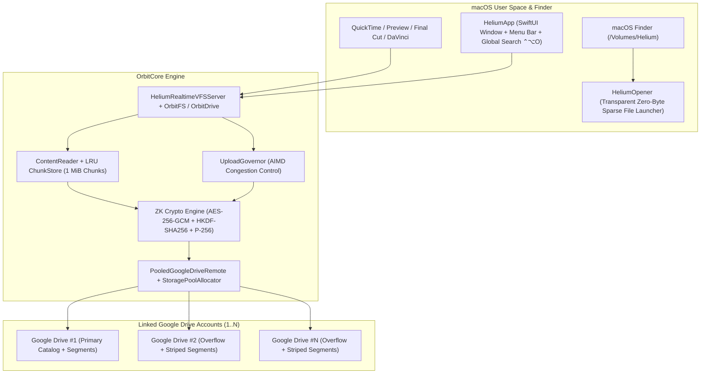

<div align="center">
  
  <h1>Helium for macOS</h1>
  <p><strong>Pool multiple Google Drive accounts into one native macOS Finder volume (<code>/Volumes/Helium</code>) with 0 KB local SSD footprint, 64 MiB RAID-0 chunk striping, and client-side AES-256-GCM zero-knowledge encryption.</strong></p>

  <p>
    <a href="https://cogify.me/helium"></a>
    
    
    <a href="LICENSE"></a>
  </p>
</div>

---

## Overview

**Helium** mounts a virtual filesystem at `/Volumes/Helium` in macOS Finder that aggregates storage across **any number of linked Google Drive accounts** into a single unified volume.

Unlike traditional sync clients that duplicate cloud files onto your internal SSD or cap out at a single account's 15 GB limit, Helium represents remote files as **0-byte APFS sparse placeholders** (`Zero bytes on disk`) and streams only the active byte ranges your applications request in real time.



---

## Key Features

- **Multi-Account Google Drive Pool**: Link unlimited Google accounts via OAuth 2.0 PKCE (`ASWebAuthenticationSession`) and combine their free quotas into one unified macOS volume (`/Volumes/Helium`).
- **Dual-Mode Storage Placement Engine (`StoragePoolAllocator`)**:
  - **Whole-File Smart Placement**: Routes standard files that fit on a single drive to your highest-priority account (or the account with the most free headroom) so files remain directly accessible in Google Drive Web.
  - **64 MiB Cross-Account RAID-0 Chunk Striping**: Automatically slices massive files (e.g., 50+ GB 4K ProRes masters or `.dmg` archives) into deterministic chunks striped across multiple Google Drives when no single account has enough free space.
- **Zero Local Disk Footprint (`0 KB on this Mac`)**: Unpinned cloud files consume `0 bytes` on your MacBook SSD while displaying their full logical size in Finder and opening directly in `QuickTime Player`, `Preview`, `Final Cut Pro`, `DaVinci Resolve`, and `DiskImageMounter`.
- **On-Demand Byte-Range Streaming (`ContentReader` + `ChunkStore`)**: Fetches, decrypts, and caches only the exact `1 MiB` chunks requested by POSIX/VNOP reads, enabling sub-second video scrubbing and instant random access.
- **Client-Side Zero-Knowledge Encryption (`ZK`)**: Optional end-to-end `AES-256-GCM` encryption with `HKDF-SHA256` key derivation and `P-256` key agreement. Master keys are stored in the local macOS Keychain, and both filenames (with HMAC uniqueness tags) and file chunks (bound to chunk index and final-chunk flags in AAD) are sealed before upload.
- **Bi-Directional Sync & 30-Day Cloud Recycle Bin**: Creating, renaming, moving, or deleting files in `/Volumes/Helium`, the Helium app, or Google Drive Web stays synchronized across your pool with a 30-day soft-delete Recycle Bin.
- **Pool Rebalancer, Priority Routing & Safe Account Drain**: Reorder account upload priorities, pause uploads on specific drives, verify SHA-256 segment integrity across the pool, or evacuate all segments off an account before unlinking it.
- **Menu Bar Quick Dropzone & Global Search (`⌃⌥O`)**: Drop files onto the smiling Helium menu bar icon for instant background offload, pin folders for offline travel, or search across every linked Google Drive in milliseconds.





---

## Architecture



See [`docs/ARCHITECTURE.md`](docs/ARCHITECTURE.md) for a deep dive into the storage allocator, manifest catalog format, chunk reader, and cryptographic protocol.

---

## Project Structure

```text
.
├── Package.swift                 # Swift Package Manager manifest (Swift 6.0 / macOS 15.4+)
├── Helium.xcodeproj/             # Xcode project for macOS app & targets
├── Config/                       # Info.plist & entitlements (Direct Distribution & App Store)
├── Resources/                    # App icons, Assets.xcassets, Help Book, PrivacyInfo.xcprivacy
├── Sources/
│   ├── OrbitCore/                # Core storage, VFS tree, crypto, and Google Drive Pool engine
│   │   ├── Concurrency/          # Async primitives, RWLock, KeyedMutex, SingleFlight
│   │   ├── Container/            # Shared container, XPC mount protocol, Keychain secret store
│   │   ├── Crypto/               # Client-side AES-256-GCM & P-256 zero-knowledge encryption (ZK)
│   │   ├── Drive/                # DriveTree, ChunkStore, ContentReader, OrbitDrive, UploadGovernor
│   │   └── Remote/               # PooledGoogleDriveRemote, StoragePoolAllocator, FirebaseConfig
│   ├── HeliumApp/                # Native SwiftUI macOS app, menu bar popover, OAuth PKCE, VFS server
│   ├── HeliumOpener/             # Helper app for double-clicking 0-byte sparse placeholders in Finder
│   ├── OrbitFS/                  # FSKit unary filesystem module
│   ├── OrbitFinder/              # FinderSync context-menu & badge extension
│   └── OrbitMountHelper/         # Volume mount helper
├── Tests/
│   └── OrbitCoreTests/           # Unit & integration test suite (pool striping, crypto, LRU cache, VFS)
├── scripts/
│   ├── build-app-bundle.sh       # Builds & packages Helium.app locally
│   └── archive-appstore.sh       # Builds Release .xcarchive, .pkg, and .dmg
└── docs/
    └── ARCHITECTURE.md           # Detailed system design & cryptographic specification
```

---

## Getting Started

### Prerequisites

- **macOS 15.4+** (Sequoia / Tahoe)
- **Xcode 16.3+** (with Swift 6.0 toolchain)

### 1. Clone the Repository

```bash
git clone https://github.com/shubhamsharma/helium.git
cd helium
```

### 2. Configure Google OAuth 2.0 Credentials

Helium uses native OAuth 2.0 with PKCE (`S256`) and a custom reversed client ID URL scheme (`com.googleusercontent.apps.<CLIENT_ID>:/oauthredirect`) so **no client secret is ever embedded in the app**.

1. Open the [Google Cloud Console](https://console.cloud.google.com/) and create or select a project.
2. Enable the **Google Drive API** under *APIs & Services › Library*.
3. Under *APIs & Services › Credentials*, click **Create Credentials › OAuth client ID** and choose **iOS** (or **macOS / Desktop**) with bundle ID `com.cogify.helium`.
4. Copy the example configuration file and fill in your `CLIENT_ID` and `REVERSED_CLIENT_ID`:

```bash
cp GoogleService-Info.plist.example GoogleService-Info.plist
# Or configure via environment variables:
cp .env.example .env
```

> **Note:** Both `GoogleService-Info.plist` and `.env` are gitignored so your credentials are never committed.

### 3. Build & Run Tests

```bash
# Build all targets via Swift Package Manager
swift build

# Run the unit and integration test suite
swift test
```

### 4. Package `Helium.app` Locally

```bash
./scripts/build-app-bundle.sh
open build/Helium.app
```

---

## Security & Zero-Knowledge Encryption

Helium is designed with a local-first security model:

- **OAuth 2.0 PKCE (`S256`)**: Tokens are exchanged directly with `oauth2.googleapis.com` and stored locally.
- **Client-Side `AES-256-GCM` (`OrbitCore.ZK`)**:
  - A 256-bit Master Key (`MK`) is generated via `SecRandomCopyBytes` and stored in macOS Keychain.
  - Subkeys (`wrap`, `nameEnc`, `nameMac`, `check`, `shareWrap`) are derived deterministically via `HKDF-SHA256`.
  - Each file receives an independent 256-bit File Key (`FK`) and 96-bit base nonce.
  - Every `1 MiB` chunk nonce is derived by XORing the big-endian chunk index into the last 8 bytes of the file nonce, and the GCM Additional Authenticated Data (`AAD`) binds both the chunk index and a `last-chunk` boolean flag to prevent chunk-reordering or truncation attacks.

See [`SECURITY.md`](SECURITY.md) for vulnerability reporting guidelines.

---

## Contributing

Contributions, bug reports, and feature requests are welcome! Please read [`CONTRIBUTING.md`](CONTRIBUTING.md) before submitting a pull request.

---

## License

Released under the [MIT License](LICENSE).  
Built with ❤️ by [cogify.me](https://cogify.me/helium) (`connect@cogify.me`).
